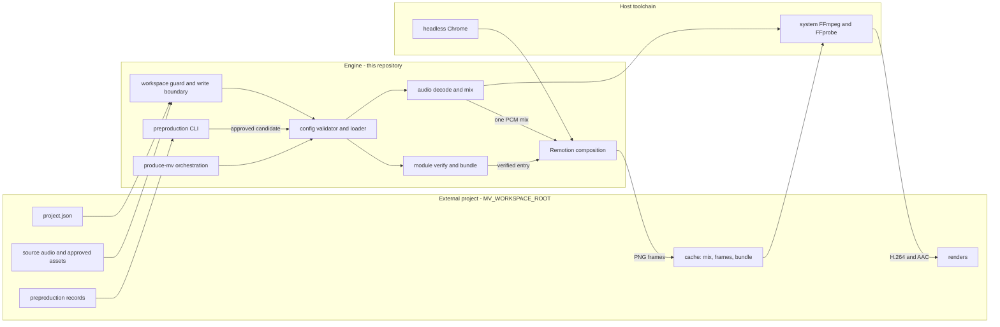
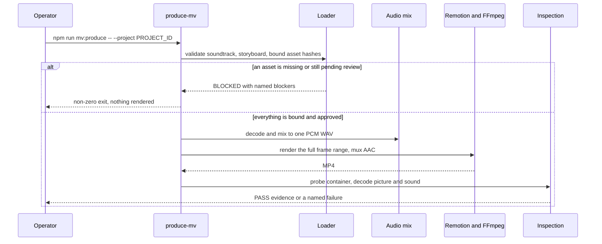

# MVFoundry

**AI Music Video Production Framework**


MVFoundry is a local-first, agent-driven framework for building music videos with Remotion. It is a reusable, song-independent engine: every actual production — its audio, lyrics, references, assets, scenes, caches and renders — lives in a separate workspace outside this repository and is loaded from configuration alone.

The framework's core discipline is that nothing is assumed. Timing comes from verified audio, assets are bound only after an explicit human review, provider work is gated and refused by default, and every acceptance claim is backed by decoded pixels or samples rather than an exit code.

## Contents

- [What MVFoundry Is](#what-mvfoundry-is)
- [Highlights](#highlights)
- [Architecture](#architecture)
- [Production Workflow](#production-workflow)
- [Capability Matrix](#capability-matrix)
- [Renderers and Visual Styles](#renderers-and-visual-styles)
- [Audio Model](#audio-model)
- [Safety Model](#safety-model)
- [Quick Start](#quick-start)
- [Configuration](#configuration)
- [Command Reference](#command-reference)
- [Project Structure](#project-structure)
- [Development and Testing](#development-and-testing)
- [Known Limitations](#known-limitations)
- [Documentation](#documentation)
- [Third-Party Components and License](#third-party-components-and-license)

## What MVFoundry Is

| This repository | An external project |
|---|---|
| Reusable engine: loaders, validators, renderers, mixer, planning, verification | One song's `project.json`, audio, assets, scene modules and records |
| Synthetic, generated test fixtures only | Every real production artifact |
| Published to `main` | Lives under `MV_WORKSPACE_ROOT`, outside this repository |

No song, recording, lyric, reference image, production scene or rendered video is part of this repository. A new production is added by creating a directory and a `project.json` — never by editing engine source.

## Highlights

**Song-independent engine**

- Projects are loaded from `MV_WORKSPACE_ROOT` with schema and coverage validation; there is no repository fallback.
- Duration, resolution, fps, shot count, renderer mix and style are project data, not engine constants.
- Two independent synthetic productions prove it: a 60-second 4/4 project and a 50-second 5/4 project with tempo changes and 4:3 output.
- Production IDs are never hardcoded; a missing or unreviewed asset returns a structured `BLOCKED` result instead of a silent substitution.

**Frame-accurate timeline and a single audio authority**

- The integer output frame is the only clock; all ranges are half-open `[start, end)`.
- Shot selection happens before renderer sampling, so a cut on an odd frame lands on that exact frame.
- Audio maps to the same clock with `Math.round(frame * sampleRate / outputFps)`, including non-integer ratios such as 44,100/24.
- One project-local PCM mix is produced and muxed as AAC exactly once; embedded video audio is always muted.

**Renderers and visual styles**

- Six renderer identities: five built-in (`pixel-canvas`, `layered-canvas`, `video`, `hybrid`, `parallax-2p5d`) plus `project:<id>` Canvas modules.
- Visual styles are a separate catalog of visual languages, not additional renderers; `svg`, `html` and `three` are declared blocked rather than faked.
- `pixel-canvas` is one selectable look, not the default: the `MV-Factory` demo composition renders a full-resolution `layered-canvas` abstract.
- Project-local Canvas 2D scene modules are hash-verified and statically screened before bundling.
- Asset-backed 2.5D compositing uses one plate, depth-ordered cutouts and a deterministic camera, with authored depth of field.

**Planning before pixels**

- A versioned beat grid reports ranked tempo candidates, ambiguity and a frame-zero detection boundary instead of inventing a tempo.
- Manual BPM, beat anchors, cut cues and sections always outrank an estimate; approval is a separate, re-validated record.
- A style-independent creative brief drives a deterministic director plan, a frame-accurate storyboard and an asset requirements manifest.
- Approved storyboards compile into a separate validated candidate; `project.json` is never overwritten automatically.

**Governed asset handoff and generation**

- `attach-asset` verifies containment, hash, real container/codec, alpha, renderer fit and source duration; only `review-asset --decision approve` binds an asset.
- Generation jobs carry deterministic identity so retries and re-preparation cannot submit the same paid work twice.
- `LIVE_PROVIDER_EXECUTION` is `NOT_GRANTED`: `submit-live` refuses, and the included Runway adapter has never been executed live.
- Provider output is typed against the submitted operation, retrieved through a screened delivery-host policy, and normalized under one reviewed profile without overwriting the original.

**Evidence-based acceptance**

- Output inspection refuses to call a file complete on a zero exit code alone.
- Decoded picture and decoded sound are measured: frame counts, sampled colors, alpha contribution, cut timing, onset timing, gain and stream policy.
- Technical acceptance and human artistic review are separate decisions; the engine never claims the second one.

## Architecture

MVFoundry is split across three boundaries: the engine in this repository, the external project that holds all production data, and the host toolchain it depends on.



### Component map

| Component | Location | Responsibility |
|---|---|---|
| Workspace guard | `factory/src/workspace/guard.ts` | Canonical workspace root, project-ID rules, link and traversal rejection |
| Write boundary | `factory/src/workspace/writeBoundary.ts` | The single validator for engine-authored writes and cache cleanup |
| Config contract | `factory/src/config/` | Types, validation, duration policy, scene-module manifest parsing |
| Loader | `factory/src/project/` | Hash, duration, FFprobe/PNG and media-timeline verification; browser-safe snapshot |
| Frame clock | `factory/src/timeline/` | Frame/shot resolution, sampling, audio frame-to-sample mapping |
| Audio engine | `factory/src/audio/`, `factory/src/media/` | Decode, normalize, deterministic PCM mixing, cue analysis, audio evidence |
| Preproduction | `factory/src/preproduction/` | Beat grid, annotations, lyrics, brief, plan, storyboard, asset manifest, compiler |
| Generation | `factory/src/generation/` | Job contract, capability manifests, providers, retrieval, pricing, ledger, preflight |
| Renderers | `factory/src/scenes/` | Renderer contracts, registry, Canvas/Video/Hybrid/2.5D implementations |
| Styles | `factory/src/style/` | Visual style catalog and role themes |
| Composition | `factory/src/remotion/` | `MV-Factory` composition, per-project bundling, browser readiness |
| Automation | `factory/scripts/` | CLIs, synthetic seeds, verifiers, fixture generation |

The full data flow, frame contract and trust boundaries are in [ARCHITECTURE.md](ARCHITECTURE.md).

## Production Workflow

A full production is one orchestrated command. It validates before it spends time, and it inspects after it renders.



The surrounding stages are local and inspectable at every step:

1. **Initialize** — `mv-project.mjs init` copies an authorized source byte-for-byte and records its hash, format, decoded duration, provenance and rights.
2. **Analyze** — audio decoding produces cue evidence marked `estimated`, never approved timing.
3. **Plan** — beat grid, manual annotations, optional lyrics and a creative brief produce a director plan and storyboard.
4. **Bind assets** — every requirement is satisfied through intake, explicit review and binding, or it stays a blocker.
5. **Compile** — an approved storyboard becomes a separate validated candidate project.
6. **Produce** — one full-range render, then decoded inspection.
7. **Review** — a project-local review package keeps technical acceptance and artistic decisions apart.

## Capability Matrix

| Area | Capability | Evidence | Status |
|---|---|---|---|
| Project contract | Typed `project.json` with schema, coverage and duration-policy validation | `factory/src/config/validate.ts` | Implemented |
| Isolation | Required external workspace, canonical paths, no repository fallback | `factory/src/workspace/guard.ts` | Implemented |
| Writes | Central write boundary for staging, renders, cache and module bundles | `factory/src/workspace/writeBoundary.ts` | Implemented |
| Timeline | Integer frame clock, half-open ranges, sampling after selection | `factory/src/timeline/` | Implemented |
| Audio | WAV/MP3/FLAC/M4A ingestion, multitrack PCM mix, one AAC mux | `factory/src/audio/mixer.ts` | Implemented |
| Analysis | Deterministic peak/RMS/onset cues with `estimated` provenance | `factory/src/audio/analysis.ts` | Implemented |
| Preproduction | Beat grid, annotations, lyrics, brief, plan, storyboard, compiler | `factory/src/preproduction/` | Implemented |
| Media | Video/PNG probing, staging, VFR-to-CFR normalization | `factory/src/media/` | Implemented |
| Renderers | Canvas, Video, Hybrid, 2.5D and trusted project modules | `factory/src/scenes/` | Implemented |
| Styles | Six Canvas 2D style profiles with declared media routes | `factory/src/style/catalog.ts` | Implemented |
| Generation | Job contract, offline provider, Runway adapter, retrieval, pricing, ledger | `factory/src/generation/` | Implemented; live execution `NOT_GRANTED` |
| Production | Full-range orchestration with output inspection | `factory/scripts/produce-mv.mjs` | Implemented |
| Agent Skills | Five project-owned Skills in `.agents/skills/` | `docs/skills.md` | Implemented |
| CI | Windows runner, pinned FFmpeg, all acceptance suites | `.github/workflows/engine-ci.yml` | Defined in the repository |
| Blocked backends | `svg`, `html`, `three` rendering | `factory/src/style/catalog.ts` | Blocked by design |

## Renderers and Visual Styles

| Renderer | Status | Behavior |
|---|---|---|
| `layered-canvas` | Implemented foundation | Full-resolution Canvas 2D with an optional approved image background; default demo look |
| `project:<id>` | Implemented | Trusted, hash-verified project-local Canvas 2D module bound per bundle |
| `video` | Implemented | Approved local H.264 MP4 with shot-local in-point, fit/scale and muted source audio |
| `hybrid` | Implemented | Video background, ordered transparent PNG layers and a deterministic Canvas overlay |
| `parallax-2p5d` | Implemented | One approved plate, depth-ordered RGBA cutouts, deterministic camera and authored depth of field |
| `pixel-canvas` | Implemented | Configurable internal resolution, nearest-neighbour display, hold-based sampling; one style, not the default |

Renderers are a discriminated union. Canvas renderers keep the `canvasSize` / `samplingFps` / `render(ctx, ...)` contract; media renderers expose a React component rendered inside a shot-local `Sequence`. Adding a renderer never changes the frame clock, and an unknown renderer fails at project load.

Visual styles are orthogonal to renderers. Six profiles are registered and implemented on Canvas 2D: `cinematic-illustration-2p5d`, `anime-motion-comic`, `ink-watercolor`, `editorial-motion-graphics`, `stylized-3d-diorama` and `retro-pixel`. They are catalog definitions plus validation contracts, not six built-in renderers: a style-driven shot must run through a project module that declares the style, or a media renderer the style explicitly lists in `mediaRoutes`. Shipped procedural art currently covers cinematic, anime and pixel; ink, editorial and diorama need supplied art or a project module. See [visual styles](docs/visual-styles.md) and [rendering](docs/rendering.md).

> **Trust boundary:** a matching SHA256 proves byte identity, not benign behavior. Importing a verified module executes its top-level code in the browser when the bundle loads. The static source policy rejects imports, network APIs, dynamic code, DOM access, timers, clocks and randomness, but it is a rejection policy, not a sandbox. Approve the whole module, not only its `render` function.

## Audio Model

The master `audio` declaration is the single duration and timeline authority. Supplemental tracks are restricted to `sfx`, `voiceover` and `ambience`, so there is no second declaration of the main music.

| Declared `audio.format` | Content required | Notes |
|---|---|---|
| `wav-pcm` | RIFF/WAVE, 16-bit PCM, mono or stereo | Pure Node metadata path |
| `mp3` | MPEG audio, MP3 codec | Decoded with FFmpeg, including encoder-delay handling |
| `flac` | FLAC stream | Lossless decode |
| `m4a-aac` | MP4/M4A container, AAC audio, exactly one audio stream | No video or additional streams |

Format is detected from the actual container or header; a filename extension is never trusted. Every source must be an approved `audio-reference` asset with a project-relative path, SHA256, source label and rights record, and its decoded duration is verified against the declaration.

Mixing is deterministic Node code over stereo signed 16-bit PCM at the project mix rate (44.1 or 48 kHz): frame-aligned source in-points, linear gain, linear fades, bounded dB automation, summation, then one documented headroom rule. If the summed peak exceeds `0.999`, a single global gain scales the whole mix down; peak before/after, limiter gain and clipping diagnostics are reported. There is no automatic loudness normalization and no silent song-wide level change to hide clipping.

Cue analysis records the source hash, algorithm version, parameters, frame and evidence metric with `source: "estimated"` and `confidence: null`. It does not claim BPM, meter, sections, emotion, lyrics or automatic music understanding, and it never rewrites approved manual cues. The full contract is in [docs/project-config.md](docs/project-config.md).

## Safety Model

- Song-specific data never belongs in this repository, and `MV_WORKSPACE_ROOT` must exist outside it.
- Workspace roots inside the repository, or that contain the repository, are rejected.
- Manifest paths are relative and canonicalized; absolute paths, parent traversal and junction or symlink escapes fail closed.
- Declared scene modules must stay under `scenes/`, be link-free and hash-verified before staging; unapproved, duplicate or cross-project modules are refused.
- Approved video assets are SHA256-verified and FFprobe-validated before rendering; layer assets must be 8-bit RGBA or grayscale-alpha PNGs.
- Video sources are local files only. HTTP media sources, unrestricted remote URLs and cross-project asset references are rejected.
- All engine-authored project writes go through the central write boundary; `--out` is restricted to direct children of the project's `renders/` directory.
- Cache cleanup is limited to strict descendants of `<project>/cache`; the project root, cache root, source audio, approved assets and declared module sources are protected.
- No public HTTP service is created for media; only Remotion's local render server is used.
- `.gitignore` is defense in depth — the workspace guard and write boundary are the primary protections.

> **Note:** write-boundary checks are path-based. Node.js filesystem APIs cannot provide an atomic openat-style guarantee, so the engine does not claim race-free protection against a concurrent local attacker who mutates the filesystem between validation and write. See [workspace safety](docs/workspace-safety.md).

## Quick Start

### Prerequisites

| Requirement | Detail |
|---|---|
| Node.js | 20 or newer (`engines` in `package.json`); CI runs Node 20 |
| npm | Use the committed `package-lock.json` |
| Browser | Google Chrome or Chromium, or `REMOTION_BROWSER_EXECUTABLE` / `CHROME_PATH`; otherwise Remotion manages its own headless browser |
| FFmpeg / FFprobe | On `PATH` for non-WAV audio, mixing, video probing, fixture generation and encoding |
| OS | Windows 10/11 x64; the engine and CI are currently maintained for Windows |

Install dependencies:

```bash
npm ci
```

The five project-owned Skills are already in `.agents/skills/`. The official Remotion Skills are not vendored and are installed separately if your agent supports Skills:

```bash
npx -y skills@1.7.0 add remotion-dev/skills \
  --skill remotion-best-practices remotion-create remotion-docs remotion-markup \
          remotion-multimedia remotion-render remotion-studio --yes
```

### Create an external workspace

```bash
# bash
export MV_WORKSPACE_ROOT=/absolute/path/outside/this/repository
```

```powershell
# PowerShell
$env:MV_WORKSPACE_ROOT = 'C:\absolute\path\outside\this\repository'
```

The directory must already exist. Then seed the synthetic projects and verify the engine:

```bash
npm test
npm run seed:examples
npm run verify:modules
```

### Render

```bash
npx remotion studio factory/src/entry.tsx
npm run render:project -- --project synthetic-layered-demo --mode video --frames 0-23
npm run render:project -- --project synthetic-module-layered-demo --mode still --frame 20
npm run render:project -- --project synthetic-pixel-demo --mode video --frames 0-23
```

Frames, caches, reports and outputs are written only inside the external project's `cache/` and `renders/` directories.

### Run the complete rehearsal

```bash
npm run mv:seed
npm run mv:verify -- --produce
```

This generates an original 60-second score, a fifteen-shot storyboard across Canvas, module, Video and Hybrid renderers, synthetic clips and layers, then produces, renders and verifies the full 1440-frame timeline with decoded picture and sound checks.

> **Note:** the commands above reflect the committed `package.json` scripts. They are source-verified, not execution-tested during this README revision; run `npm test` first to confirm your environment.

## Configuration

`MV_WORKSPACE_ROOT` is required for loading, seeding or rendering any project:

- it must exist, be outside this repository, and must not contain this repository;
- every project is a direct child whose folder name equals its `projectId`;
- missing configuration fails closed — there is no repository fallback;
- production audio, references, generated assets, caches and renders stay under the workspace.

A project is a directory plus a `project.json`:

```text
<MV_WORKSPACE_ROOT>/<projectId>/
  project.json
  source/audio/...
  scenes/            # optional, for project-local modules
  preproduction/     # optional, written by the planning CLI
  cache/             # generated: normalized audio, mix, frames, bundles
  renders/           # generated output
```

The configuration contract covers identity, song metadata, the master audio declaration, optional `audioTracks`, output size/fps, cues, chapters and shots, optional `sceneModules`, typed `media` for Video/Hybrid/2.5D shots, asset approvals and local-only permissions. Read the full field rules in [docs/project-config.md](docs/project-config.md).

Create a project from explicit inputs rather than by hand:

```bash
node factory/scripts/mv-project.mjs init \
  --project my-song --workspace "$MV_WORKSPACE_ROOT" \
  --width 1280 --height 720 --fps 24 \
  --audio /path/to/master.wav \
  --source "purchased download" --rights "owned by the operator"
```

`init` never scans folders. A user-declared rights assertion is an operational record, not independent verification of copyright ownership.

## Command Reference

| Command | Purpose |
|---|---|
| `npm run typecheck` / `npm run build` | Type-check or compile the engine into `factory/dist` |
| `npm test` | Generate fixtures, build, run the engine test suite |
| `npm run seed:examples` | Create the four declarative and module projects |
| `npm run media:seed` / `media:verify` | Video and Hybrid projects, then decoded still and video checks |
| `npm run audio:seed` / `audio:verify` | MP3, FLAC multitrack and 44.1 kHz boundary projects, then decoded audio checks |
| `npm run preproduction:seed` / `preproduction:verify` | Four planning projects, then the full plan-to-preview workflow |
| `npm run handoff:seed` / `handoff:verify` | Media-aware storyboards, continuity and asset handoff |
| `npm run generation:seed` / `generation:verify` | Generation jobs against the offline provider |
| `npm run provider:seed` / `provider:verify` | Simulated remote results to validated assets and real renders |
| `npm run golive:seed` / `golive:verify` | Pricing, spend locks, transport policy and crash recovery |
| `npm run pilot:seed` / `pilot:verify` | Pilot admission, one-shot submission ownership, transport wiring |
| `npm run mv:seed` / `mv:verify -- --produce` | Complete synthetic music video, produced and verified |
| `npm run mv:seed-b` / `mv:verify-b` | Independent 50-second 5/4 project proving engine independence |
| `npm run onboarding:seed` / `onboarding:verify` | Creator onboarding from fresh init to a decoded 900-frame MP4 |
| `npm run style:verify` / `style:media:verify` | Six-style decoded-pixel matrix; mixed-media style timelines |
| `npm run style:gallery:seed` | Seed six runnable synthetic projects, one per registered style, in an external workspace |
| `npm run verify:modules` | Module bundling and still-render evidence |
| `npm run audit:git` / `audit:publication` | Media-in-Git audit and publication allowlist audit |

Planning and production CLIs:

| Command | Commands available |
|---|---|
| `npm run preproduction -- <command> --project ID` | `analyze-beats`, `beat-grid-candidates`, `approve-beats`, `validate`, `plan`, `approve-plan`, `storyboard`, `approve-storyboard`, `report-assets`, `compile`, `render-preview` |
| `npm run generation -- <command> --project ID` | `prepare`, `status`, `inspect`, `run-offline`, `resume`, `retrieve`, `normalize`, `stage`, `review`, `blockers`, `report`, and more; `submit-live` always refuses |
| `npm run mv:produce -- --project ID` | Validate, compile, render the full range and inspect the output |
| `npm run mv:workflow -- help` | Guided iteration: `status`, `next`, `shots`, `inspect-shot`, `preview-shot`, `edit-shot`, `approve-revision`, `review-shot`, `compare`, `render-readiness`, `review-package` |
| `npm run style -- list` | `list`, `inspect --id <style>`, `check --project <id>` |

`mv:workflow` exit codes are `0` success, `2` refused or invalid, and `3` status or readiness blocked. See [operator workflow](docs/operator-workflow.md).

## Project Structure

```text
MVFoundry/
├── factory/
│   ├── src/
│   │   ├── config/         project schema, validation, duration policy
│   │   ├── workspace/      workspace guard and central write boundary
│   │   ├── timeline/       frame clock, shot resolver, audio clock
│   │   ├── scenes/         renderer contracts, registry, Canvas/Video/Hybrid/2.5D
│   │   ├── style/          visual style catalog and role themes
│   │   ├── media/          hashing, audio/video/PNG probes, normalization, staging
│   │   ├── audio/          deterministic PCM mixer, cue analysis, audio evidence
│   │   ├── preproduction/  beat grid, annotations, plan, storyboard, compiler
│   │   ├── generation/     job contract, providers, retrieval, pricing, ledger
│   │   ├── project/        loader, snapshot, scene-module binding
│   │   ├── remotion/       MV-Factory composition and per-project bundling
│   │   ├── art/            programmatic plate and character artwork
│   │   ├── audit/          read-only Git media audit
│   │   └── entry.tsx       Remotion entry point
│   ├── scripts/            CLIs, seeds, verifiers, fixture generation
│   ├── examples/           synthetic project templates (no media committed)
│   └── tests/              engine test suite
├── docs/                   configuration, rendering, safety, styles, generation
├── security/               publication allowlist and audit
├── .agents/skills/         five project-owned Skills
├── .github/workflows/      Windows CI with pinned FFmpeg
├── AGENTS.md               engine invariants for contributors and agents
├── ARCHITECTURE.md         system boundary, data flow, frame contract
├── LICENSE                 MIT license for this repository's own source
└── THIRD_PARTY_NOTICES.md  license and provenance notes
```

Synthetic templates ship as configuration only. Video, audio and image binaries are generated into an external workspace by the seed scripts and are never committed.

## Development and Testing

```bash
npm run typecheck
npm test
```

`npm test` regenerates synthetic fixtures, compiles the engine and runs 43 test files covering configuration, workspace isolation, the write boundary, staging and cleanup, junction behavior, frame ownership, sampling isolation, multi-project loading, module path/hash/trust/source rejection, runtime binding, media probing and timing, audio mixing, Git audit and provider absence.

Base WAV and PNG fixtures are generated by a committed pure-Node script, so the core suite does not require FFmpeg. Media and multi-format audio tests create disposable synthetic files with FFmpeg and are skipped when it is unavailable; acceptance suites report `NOT RUN` rather than passing silently.

CI (`.github/workflows/engine-ci.yml`) runs on `windows-latest` with Node 20, provisions a checksum-verified FFmpeg/FFprobe build, verifies the required `libx264`, `libmp3lame`, `aac` and `flac` encoders, then runs typecheck, tests, module and style evidence, and the media, audio, preproduction, handoff, generation, provider, go-live, pilot, complete-MV, independent-project, onboarding and workflow acceptance suites. Provisioning or encoder failure fails the job; there is no conditional-skip path, and no artifacts or production media are uploaded.

Reproducibility rules: no unseeded randomness or wall-clock time in drawing, frame-derived values only for modules, and a static policy that rejects clock, timer and randomness APIs.

## Known Limitations

- **Video sources** — approved local MP4/H.264 constant-frame-rate, zero-rotation files only. VFR and rotated media must be preprocessed; `endBehavior` supports `reject` only.
- **Audio processing** — gain, linear fades, explicit automation and manual ducking envelopes. No compression, EQ, reverb, automatic ducking, loudness targets or music understanding.
- **Beat grid** — assumes constant tempo and reports ambiguity rather than resolving it. No meter, downbeats, sections, BPM changes or lyrics are inferred.
- **Preview vs final** — preview uses the PCM mix, final output uses AAC of the same mix. Semantic alignment is verified; sample-identical playback is not claimed.
- **2.5D compositing** — layered cardboard parallax with authored blur, not volumetric 3D. Occlusion is only what the supplied alpha art provides.
- **Scene modules** — Canvas 2D only, self-contained, synchronous `render`. No asynchronous image-loading helper, no OS sandbox, no browser network interception.
- **Generation** — `LIVE_PROVIDER_EXECUTION` is `NOT_GRANTED`; the Runway adapter has never been executed live, and the P0 project policy refuses external generation.
- **Filesystem safety** — path-based validation cannot prevent concurrent mutation races.
- **Platform** — Windows only at present.
- **Dependencies** — the tree carries 10 high npm advisories, all transitive through `zod@4.5.4` pinned by Remotion. Accepted and tracked in [docs/dependency-security.md](docs/dependency-security.md), not resolved.
- **CI evidence** — the workflow is defined in the repository; remote runs are not asserted by this document.

## Documentation

| Document | Contents |
|---|---|
| [ARCHITECTURE.md](ARCHITECTURE.md) | System boundary, data flow, frame contract, trust boundaries |
| [AGENTS.md](AGENTS.md) | Hard invariants for anyone changing the engine |
| [docs/project-config.md](docs/project-config.md) | Complete `project.json` contract and field rules |
| [docs/rendering.md](docs/rendering.md) | Frame clock, render pipeline, output policy, verification |
| [docs/workspace-safety.md](docs/workspace-safety.md) | Workspace root and path policy |
| [docs/preproduction.md](docs/preproduction.md) | Beat grid, annotations, lyrics, plan, storyboard, compilation |
| [docs/visual-styles.md](docs/visual-styles.md) | Style versus backend versus asset production |
| [docs/generation.md](docs/generation.md) | Generation jobs, provider adapters, media lifecycle |
| [docs/operator-workflow.md](docs/operator-workflow.md) | Guided local iteration, previews and reviews |
| [docs/skills.md](docs/skills.md) | The five project-owned Skills and discovery rules |
| [docs/official-skills.md](docs/official-skills.md) | External Remotion Skills revision and install |
| [docs/dependency-security.md](docs/dependency-security.md) | Advisory review and remediation decision |

## Third-Party Components and License

- [Remotion](https://www.remotion.dev/) — video framework. Remotion has its own license terms; review <https://remotion.pro/license> before commercial use.
- [React](https://react.dev/) — MIT.
- [TypeScript](https://www.typescriptlang.org/) — Apache-2.0.
- [FFmpeg](https://ffmpeg.org/) — LGPL/GPL depending on the build; this repository does not bundle FFmpeg.
- [Remotion Skills](https://github.com/remotion-dev/skills) — installed separately, not vendored here.
- GitHub Actions standard actions (`actions/checkout`, `actions/setup-node`) — used only in CI, not vendored.

Synthetic fixtures are generated locally and contain no third-party media. See [THIRD_PARTY_NOTICES.md](THIRD_PARTY_NOTICES.md) for license and provenance notes.

This repository is released under the [MIT License](LICENSE). The MIT grant covers MVFoundry's own source only: Remotion, FFmpeg and the npm dependency tree keep their own terms, so a permissive license on the engine does not extend or replace those obligations.
